# Sistema de Cálculo de Horas Pagas

API REST para registrar las horas trabajadas por los empleados y calcular cuánto se les paga, con recargo por horas extra.

Hecha con **Node.js**, **Express 5**, **MongoDB (Mongoose)** y **Zod** para validar los datos de entrada. Incluye documentación interactiva con **Swagger UI** y tests del cálculo de pago.

## Regla de negocio

El valor por hora sale del **rol** del empleado. Por cada registro diario:

| Horas trabajadas      | Cómo se pagan                     |
| --------------------- | --------------------------------- |
| Las primeras 8        | Al valor normal de la hora        |
| Las que superan las 8 | Al **150 %** del valor de la hora |

Ejemplo: un Administrativo ($4.000 la hora) que trabaja 10 horas cobra
`8 × 4.000 + 2 × 4.000 × 1,5 = $44.000`.

Para que la regla sea correcta, **un empleado solo puede tener un registro por día**. Si se intenta cargar un segundo registro el mismo día, la API responde `400`.

## Requisitos

- **Node.js 20.11 o superior** (`node -v` para comprobarlo)
- **pnpm** (`npm i -g pnpm`)
- **MongoDB Community Server** corriendo en el puerto `27017`, o una URI de MongoDB Atlas

> **MongoDB Compass no alcanza:** es solo la aplicación para ver los datos. El servidor es _MongoDB Community Server_. En Windows, durante la instalación hay que dejar tildado **"Install MongoD as a Service"** para que arranque solo.

## Instalación

```bash
pnpm install
```

Copiá el archivo de ejemplo de variables de entorno:

```bash
# Linux / macOS
cp .env.example .env

# Windows (PowerShell o CMD)
copy .env.example .env
```

| Variable    | Descripción               | Valor del ejemplo                               |
| ----------- | ------------------------- | ----------------------------------------------- |
| `PORT`      | Puerto del servidor       | `3000`                                          |
| `MONGO_URI` | URI de conexión a MongoDB | `mongodb://127.0.0.1:27017/sistema_horas_pagas` |

> El archivo `.env` no se sube a Git. Cada entorno tiene el suyo.

## Datos de prueba (seed)

```bash
node src/seed.js
```

Crea 3 roles (Administrativo, Operario, Supervisor), 3 empleados y 3 registros de horas.

> ⚠️ **Borra toda la base de datos** antes de cargar los datos. Por seguridad, solo funciona si `MONGO_URI` apunta a `localhost` o `127.0.0.1`. Con MongoDB Atlas hay que cargar los datos a mano desde Swagger.

## Ejecución

```bash
pnpm dev     # modo desarrollo (se reinicia al guardar)
pnpm start   # modo normal
```

Si todo está bien, la terminal muestra:

```
Conectado a MongoDB
Servidor iniciado en http://localhost:3000
```

> `pnpm dev` reinicia solo cuando cambia un archivo `.js` o `.json`. Si modificás `swagger.css` o `swagger.yaml`, escribí `rs` en la terminal para reiniciar.

## Documentación interactiva

Con el servidor corriendo, abrí **http://localhost:3000/api-docs** (Swagger UI). Ahí se ven todos los endpoints, con ejemplos, y se pueden probar con el botón **Try it out**.

Para probar rápido el cálculo de pago:

1. `GET /empleados` y copiá el `_id` de un empleado.
2. `POST /registros-horas` con ese `_id`.
3. Mirá `calculo.totalPagar` en la respuesta.

## Endpoints

Todos bajo el prefijo `/api/v1`.

| Recurso            | Método | Ruta                   | Descripción                                       |
| ------------------ | ------ | ---------------------- | ------------------------------------------------- |
| Roles              | GET    | `/roles`               | Listar roles                                      |
|                    | GET    | `/roles/:id`           | Obtener un rol                                    |
|                    | POST   | `/roles`               | Crear un rol                                      |
|                    | PUT    | `/roles/:id`           | Reemplazar un rol                                 |
|                    | DELETE | `/roles/:id`           | Eliminar un rol                                   |
| Empleados          | GET    | `/empleados`           | Listar empleados (con su rol)                     |
|                    | GET    | `/empleados/:id`       | Obtener un empleado                               |
|                    | POST   | `/empleados`           | Crear un empleado                                 |
|                    | PUT    | `/empleados/:id`       | Reemplazar un empleado                            |
|                    | DELETE | `/empleados/:id`       | Eliminar un empleado                              |
| Registros de horas | GET    | `/registros-horas`     | Listar registros, cada uno con su cálculo de pago |
|                    | GET    | `/registros-horas/:id` | Obtener un registro con su cálculo                |
|                    | POST   | `/registros-horas`     | Crear un registro                                 |
|                    | PUT    | `/registros-horas/:id` | Reemplazar un registro                            |
|                    | DELETE | `/registros-horas/:id` | Eliminar un registro                              |

> Los ID son **números autoincrementales** (`1`, `2`, `3`, ...). No son el ObjectId
> largo de MongoDB. En los cuerpos JSON se pueden enviar como número (`1`) o como
> texto numérico (`"1"`); la API los convierte a número.

### Ejemplo: cargar horas

```http
POST /api/v1/registros-horas
Content-Type: application/json

{
  "empleadoId": 1,
  "fecha": "2026-11-03",
  "horasTrabajadas": 10
}
```

Respuesta `201`:

```json
{
  "status": "success",
  "data": {
    "registro": {
      "_id": 1,
      "empleadoId": 1,
      "fecha": "2026-11-03",
      "horasTrabajadas": 10
    },
    "calculo": {
      "empleado": "Juan Pérez",
      "horasTrabajadas": 10,
      "horasNormales": 8,
      "horasExtra": 2,
      "valorHora": 4000,
      "pagoNormal": 32000,
      "pagoExtra": 12000,
      "totalPagar": 44000
    }
  }
}
```

### Formato de las respuestas

Éxito:

```json
{ "status": "success", "data": {} }
```

Error:

```json
{
  "status": "error",
  "message": "Error de validación",
  "errors": [
    {
      "campo": "horasTrabajadas",
      "mensaje": "No se pueden registrar más de 24 horas por día"
    }
  ]
}
```

| Código | Cuándo                                                                 |
| ------ | ---------------------------------------------------------------------- |
| `200`  | Consulta, modificación o eliminación correcta                          |
| `201`  | Recurso creado                                                         |
| `400`  | Datos inválidos, ID mal formado, valor duplicado o regla de integridad |
| `404`  | El recurso o la ruta no existe                                         |
| `500`  | Error interno (el detalle se registra en el servidor, no se expone)    |

### Reglas de integridad

- No se puede eliminar un **rol** que tenga empleados asignados.
- No se puede eliminar un **empleado** que tenga registros de horas.
- El **DNI** (7 u 8 dígitos) y el **nombre del rol** son únicos.
- Un empleado tiene **un solo registro por día**.
- Las horas de un registro van de más de 0 hasta 24.
- Las fechas se devuelven como `AAAA-MM-DD`, sin hora.

## Tests

```bash
pnpm test
```

Son 9 tests del cálculo de pago (horas normales, extras, decimales, jornada máxima, rol sin asignar). Usan el runner nativo de Node y **no necesitan base de datos**.

## Prueba rápida desde la terminal

Con el servidor corriendo y los datos del seed:

```bash
curl -s http://localhost:3000/api/v1/roles
curl -s -w "\nHTTP %{http_code}\n" http://localhost:3000/api/v1/empleados/999
```

El segundo debe responder `404`. En Windows PowerShell hay que escribir `curl.exe` en lugar de `curl`.

## Solución de problemas

| Error en la terminal                                               | Causa y solución                                                                                                                                       |
| ------------------------------------------------------------------ | ------------------------------------------------------------------------------------------------------------------------------------------------------ |
| `connect ECONNREFUSED 127.0.0.1:27017`                             | No hay un servidor MongoDB corriendo. Instalá _MongoDB Community Server_ o iniciá el servicio (`net start MongoDB`, en PowerShell como administrador). |
| `The uri parameter to openUri() must be a string, got "undefined"` | Falta el archivo `.env`. Copiá `.env.example` a `.env`.                                                                                                |
| `EBADDEVENGINES` al instalar                                       | El proyecto usa pnpm. Instalalo con `npm i -g pnpm` y usá `pnpm install`.                                                                              |
| Error en `import.meta.dirname`                                     | Node demasiado viejo. Actualizá a la versión 20.11 o superior.                                                                                         |
| `ENOENT ... swagger.css`                                           | Falta el archivo `src/docs/swagger.css`.                                                                                                               |
| `EADDRINUSE`                                                       | El puerto está ocupado. Cambiá `PORT` en el `.env`.                                                                                                    |

## Capturas de funcionamiento

Todas las capturas se sacaron desde Swagger UI (`/api-docs`), con la URL, el código y el cuerpo de la respuesta a la vista.

### Arranque y tests

| Captura                                                            | Qué muestra                                                |
| ------------------------------------------------------------------ | ---------------------------------------------------------- |
| 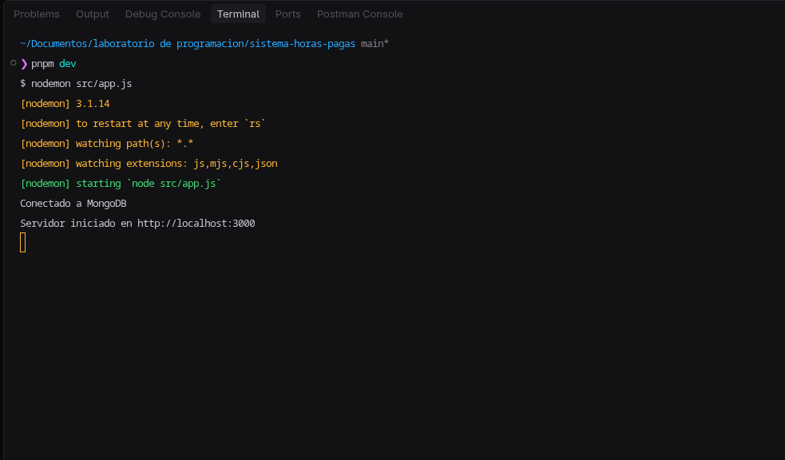          | `pnpm dev`: conexión a MongoDB y servidor iniciado         |
| 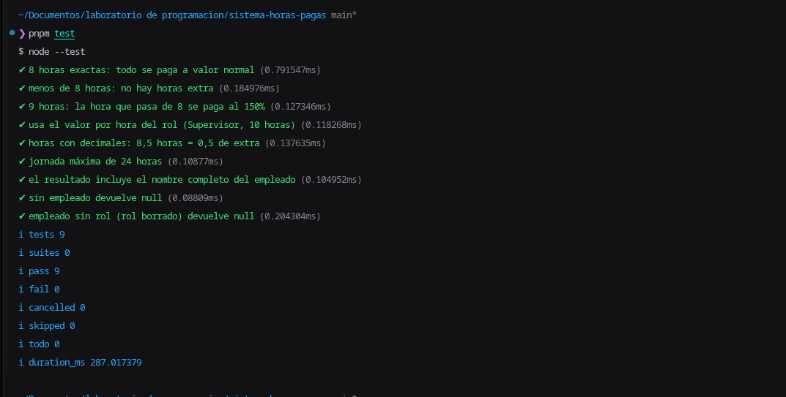                                    | `pnpm test`: 9 tests en verde                              |
| 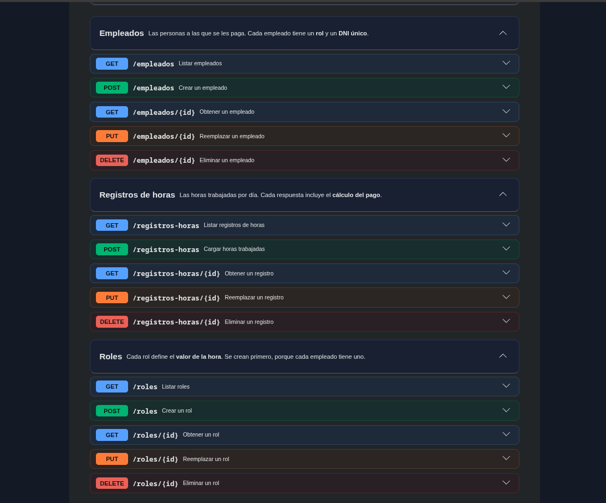 | Documentación interactiva con los tres grupos de endpoints |

### Respuestas correctas (200 y 201)

| Captura                                                              | Qué muestra                                                                        |
| -------------------------------------------------------------------- | ---------------------------------------------------------------------------------- |
| 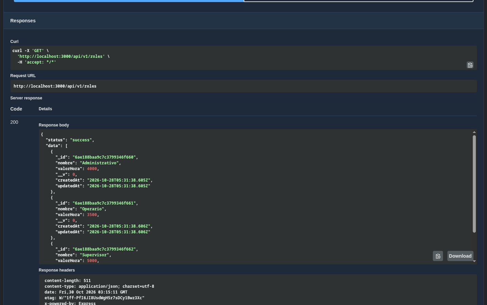                          | `GET /roles` → **200**                                                             |
| 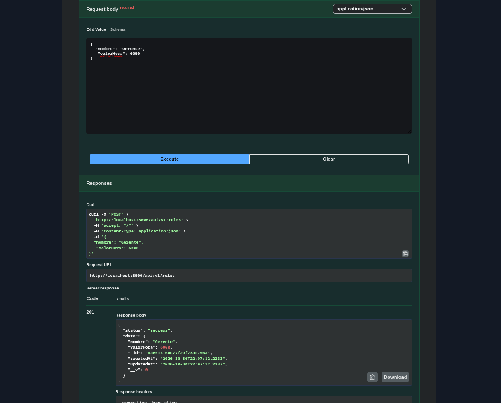                        | `POST /roles` → **201**                                                            |
| 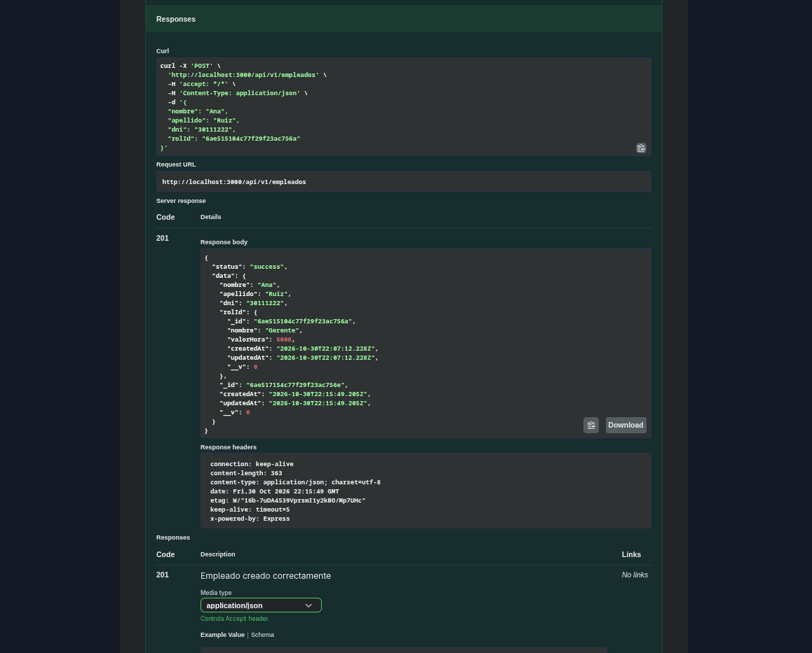                | `POST /empleados` → **201**, con el rol completo                                   |
| 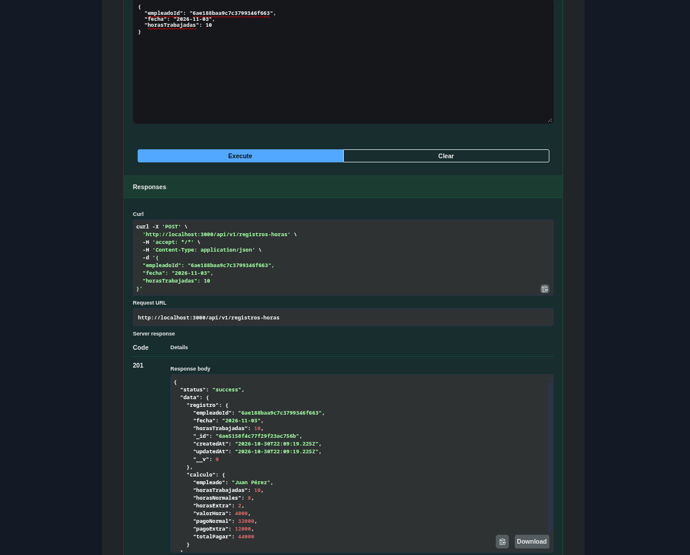       | `POST /registros-horas` con 10 horas → **201**: 8 normales + 2 extra = **$44.000** |
| 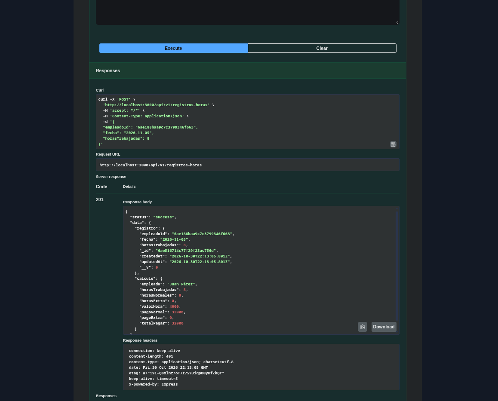 | `POST /registros-horas` con 8 horas → **201**: sin extras = **$32.000**            |

### Errores controlados (400)

| Captura                                                                | Qué muestra                                 |
| ---------------------------------------------------------------------- | ------------------------------------------- |
| 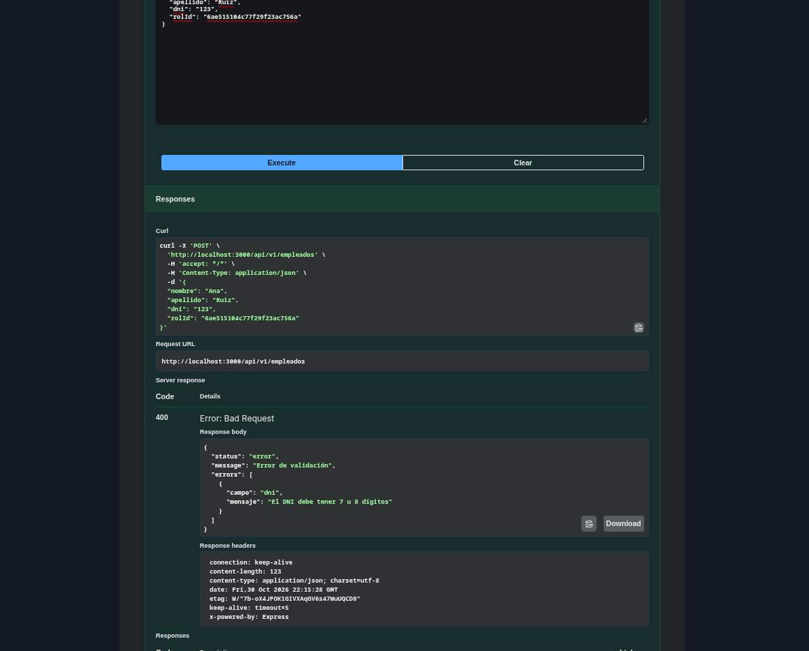                | DNI de menos de 7 dígitos                   |
| 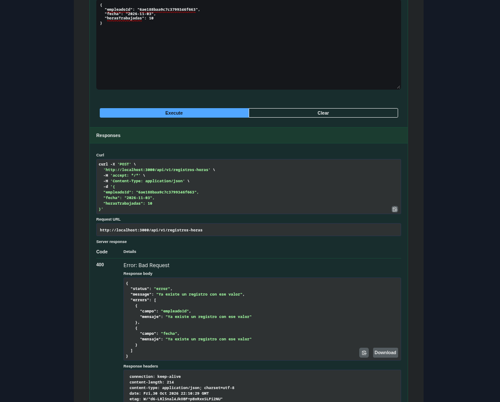       | El empleado ya tiene horas cargadas ese día |
| 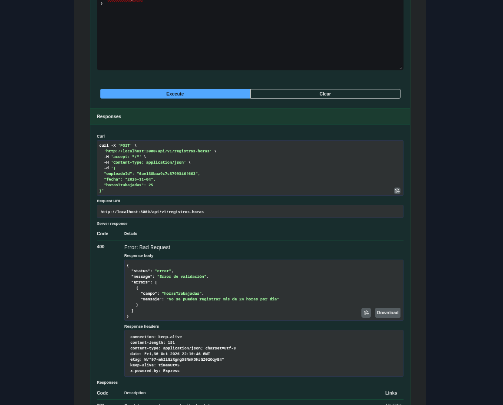 | Horas fuera de rango                        |
| 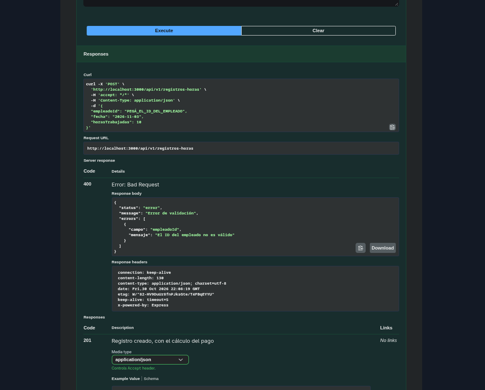         | `empleadoId` con formato incorrecto         |

## Estructura

```
src/
├── app.js            # Punto de entrada: Express, rutas, Swagger
├── seed.js           # Datos de prueba
├── config/           # Conexión a MongoDB
├── routes/           # URL + método HTTP → controlador
├── controllers/      # Manejo de req/res y códigos de estado
├── services/         # Lógica de negocio (incluye el cálculo de pago)
├── models/           # Esquemas de Mongoose (incluye Contador para los ID autoincrementales)
├── schemas/          # Validación de entrada con Zod
├── middlewares/      # Validación y manejo centralizado de errores
├── utils/            # AppError
└── docs/             # swagger.yaml (OpenAPI 3) y swagger.css
test/                 # Tests con el runner nativo de Node
```

## Arquitectura

Cada petición atraviesa las capas en este orden, y cada capa solo conoce a la siguiente:

```
Ruta → Validación (Zod) → Controlador → Servicio → Modelo → MongoDB
```

- **Rutas:** mapean método HTTP y URL a un controlador.
- **Validación:** un middleware con esquemas Zod rechaza datos inválidos antes de llegar al controlador.
- **Controladores:** manejan `req` y `res`. No tienen reglas de negocio.
- **Servicios:** aplican las reglas (cálculo de pago, integridad). No conocen HTTP.
- **Modelos:** esquemas de Mongoose. Son lo único que toca la base de datos.
- **Errores:** un middleware central convierte cualquier error en la respuesta con el formato estándar.
